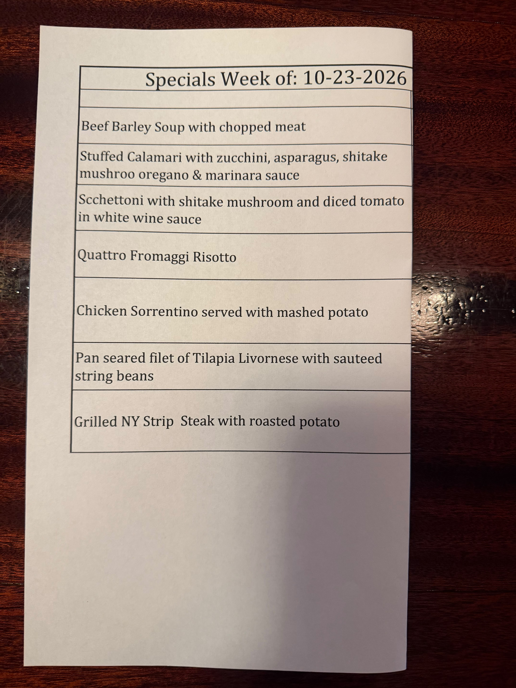
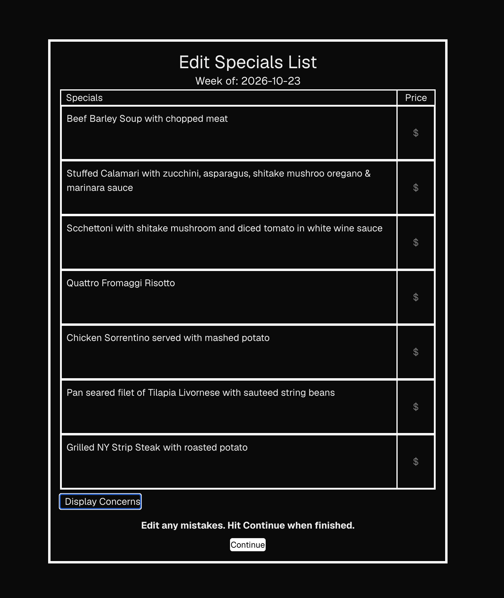

# Menu Decoder 

`Menu Decoder` turns a photo of a restaurant's weekly specials into an editable list, then explains each dish (ingredients, allergens, wine pairing) for waiters.


## Demo 




### Why ?

I work as a server at an Italian restaraunt, and the specials change every week. Before eachs ift, I need to know every dish well enough to answer guest questions on the spot. I wanted a tool that allows you to:

- **Capture the specials in seconds.** Snap a photo of the board instead of copying it by hand.
- **Catch mistakes before they spread.** Review and fix the extracted list, since a misread dish or price is worse than none.
- **Know the ingrediants of each dish.** Read other popular ingredients that aren't explicitly labled, but must be included.
- **Answer allergy questions confidently.** See each dish's likely allergens, where a wrong answer can hurt a guest.
- **Recommend a wine without guessing.** Get a pairing suggestion for (almost) every special.
- **Look back at past weeks.** Saved menus make a returning special instant to review.


## Status
- [X] Structured extraction with Claude
- [X] Editable review screen
- [ ] Dish explanations
- [ ] Saved menu history
- [ ] Deployment

## Tech Stack

| Layer | Technology | Why |
|---|---|---|
| Frontend | **Next.js + React + TypeScript** | The page stays a server component, only the upload/review form is a client component, so interactivity is limited to where it's needed. |
| Styling | **Tailwind CSS** | Utility classes keep layout and styling next to the markup. |
| Backend | **FastAPI (Python)**, Pydantic | Async endpoints, since each request spends most of its time waiting on Claude. Also has built in request validation.  One `Menu` model defines Claude's structured output *and* the API response, so the frontend reads typed fields instead of parsing text. |
| AI | **Claude API (Anthropic Python SDK)** | Vision reads the photographed board and structured outputs return data that matches the schema. The API key stays on the server, so the browser never calls Claude directly. |
| Database | **PostgreSQL (Docker locally) + SQLAlchemy** | Saved weeks need durable storage. A `menus` → `specials` one-to-many schema gives each dish its own row for ingredients, allergens, and pairings. |


## Architecture
```mermaid
flowchart LR
  A[Browser<br/>Next.js] -->|photo| B[FastAPI]
  B -->|image + schema| C[Claude API]
  C -->|structured Menu| B
  B -->|JSON| A
  B -.->|saved confirmed menu| D[(PostgreSQL)]